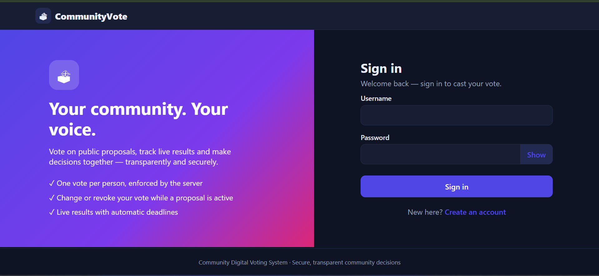
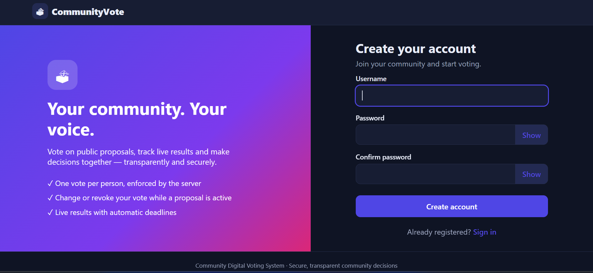
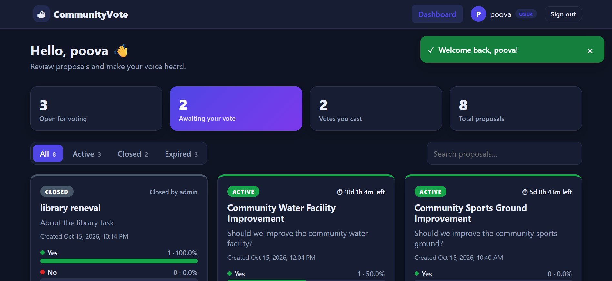
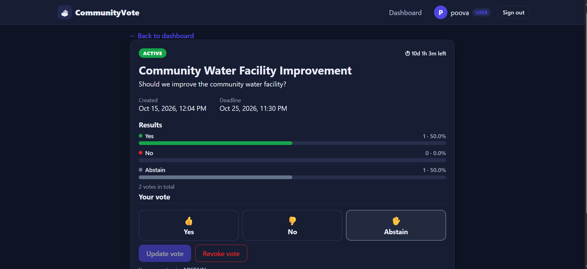
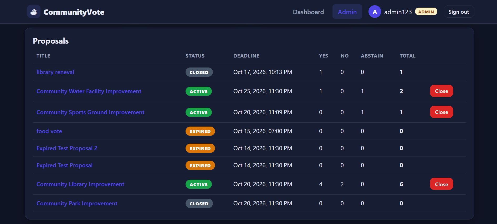
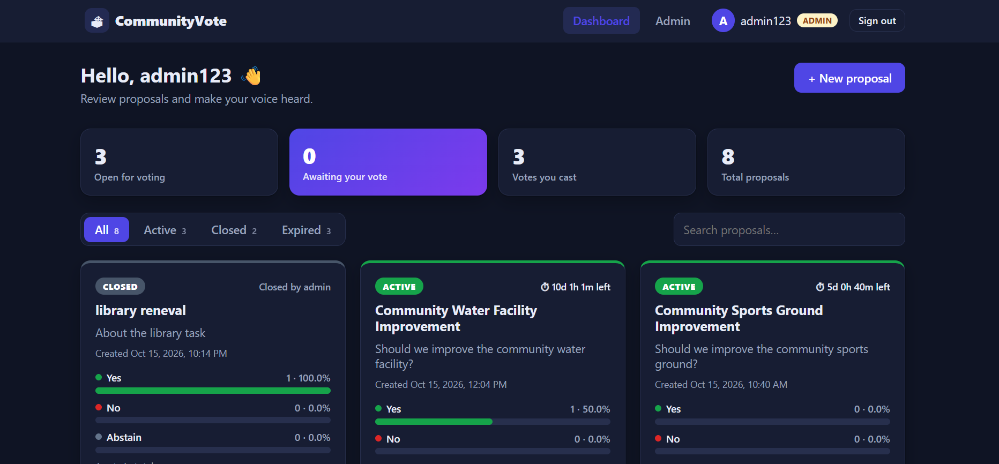
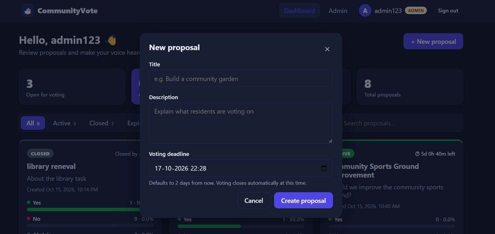
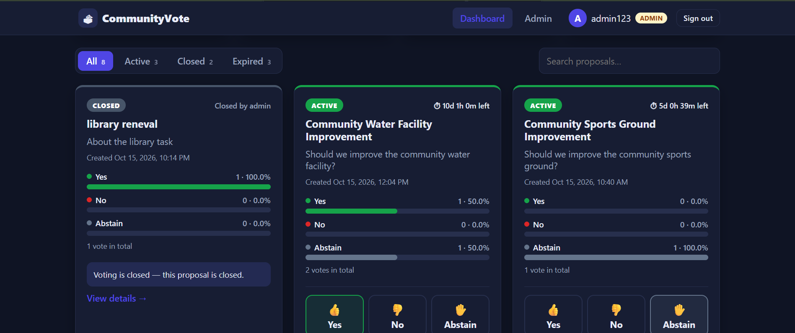

# 🗳️ Community Digital Voting System

A secure and user-friendly web-based platform for conducting
community voting digitally.

The Community Digital Voting System allows authenticated users to
view community proposals, cast votes, and view voting results.
Administrators can create and manage proposals through a
role-based administration system.

---

## 📌 Problem Statement

Traditional community voting can be time-consuming and difficult to
manage. Maintaining voter records, preventing duplicate voting,
managing proposals, and calculating results manually can lead to
inefficiency and errors.

The **Community Digital Voting System** provides a centralized
digital platform to make the community voting process more
organized, secure, transparent, and user-friendly.

---

## 💡 Solution

The system digitizes the complete community voting process.

Users can:

- Register and log in
- View community proposals
- Check proposal status and deadline
- Vote using **YES, NO, or ABSTAIN**
- Prevent duplicate voting
- View voting results

Administrators can:

- Log in securely
- Create community proposals
- Manage proposals
- View voting results

The backend enforces authentication, authorization, validation,
proposal status rules, deadline validation, and duplicate-vote
prevention.

---

## ✨ Features

### 👤 User Features

- User registration
- Secure login
- JWT-based authentication
- View community proposals
- View proposal status
- View proposal deadline
- Vote YES / NO / ABSTAIN
- One vote per user per proposal
- View voting results
- Logout

### 👨‍💼 Admin Features

- Admin authentication
- Role-based access control
- Admin dashboard
- Create proposals
- Manage proposals
- View voting results

### 🔐 Security Features

- Password hashing
- JWT authentication
- Role-based authorization
- Protected API endpoints
- Input validation
- Duplicate-vote prevention
- Database-level unique constraint

---

# 🖥️ Application Screenshots

## 🔐 Login

Users can securely log in to the application using their credentials.



---

## 📝 Registration

New users can create an account using the registration page.



---

## 🏠 User Dashboard

The user dashboard displays available community proposals along with
their current status and deadline.



---

## 🗳️ Voting

Users can select one of the available voting options:

- YES
- NO
- ABSTAIN

and submit their vote.



---

## 📊 Voting Results

The results section displays the votes recorded for each proposal.



---

## 👨‍💼 Admin Dashboard

Administrators have access to proposal management and administrative
functionality.



---

## ➕ Create Proposal

Administrators can create new community proposals by providing the
required proposal information.



---

## 📋 Proposal Status

Proposals are displayed with their appropriate status such as:

- ACTIVE
- CLOSED
- EXPIRED



---

# 🏗️ System Architecture

```text
                    USER / ADMIN
                         |
                         v
                 React Frontend
                         |
                       Axios
                         |
                         v
                  FastAPI Backend
                         |
              +----------+----------+
              |                     |
              v                     v
      Authentication          Business Logic
              |                     |
              +----------+----------+
                         |
                    SQLAlchemy
                         |
                         v
                     SQLite
                         |
              +----------+----------+
              |                     |
              v                     v
            Users              Proposals
                                    |
                                    v
                                  Votes